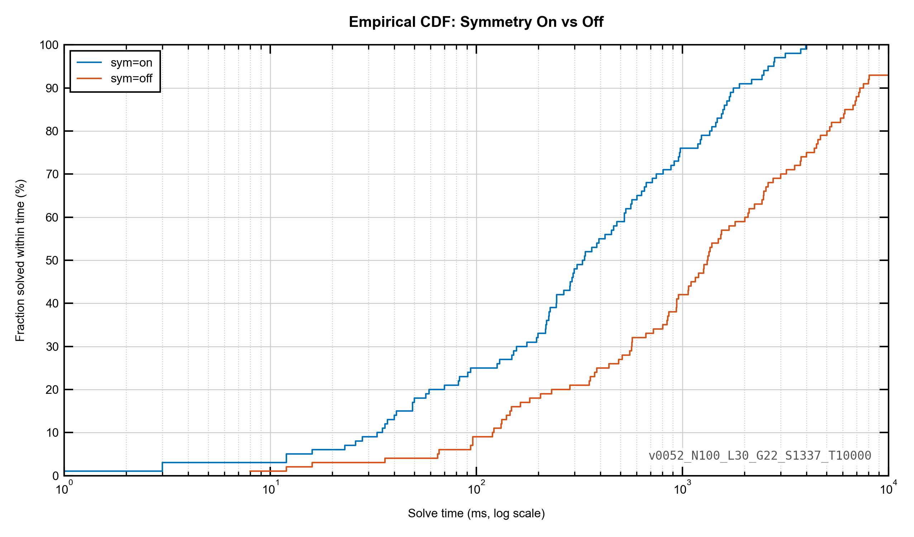
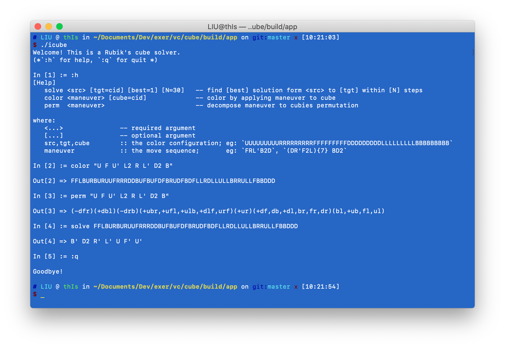

# Cube

[](LICENSE)
[](https://github.com/coshz/cube/releases)
[](https://hackage.haskell.org/package/cube-hs)
[](https://crates.io/crates/cube-rust)
[](https://pypi.org/project/cube-python/)
[](https://www.npmjs.com/package/@coshz/jscube)

An ultra-fast, cross-platform Rubik's Cube solver engine built with modern C++17, implementing Kociemba's Two-Phase Algorithm.

## ✨ Features

- **⚡ High Performance**: Fast and resource-efficient core implementation.
- **🌐 Multi-Language**: Native bindings for Python, Rust, Haskell, and WebAssembly/TypeScript.
- **📦 Cross-Platform SDK**: Ships C dynamic/static libraries, Swift module (`Cube.framework`), and interactive CLI (`icube`).
- **🛠️ Standalone**: Zero external third-party dependencies.

## 📦 Language Bindings

| Language       | Directory & Guide                              | Package                                                      |
| :------------- | :--------------------------------------------- | :----------------------------------------------------------- |
| **Python**     | [bindings/python](bindings/python/README.md)   | [cube-python](https://pypi.org/project/cube-python/)         |
| **Rust**       | [bindings/rust](bindings/rust/README.md)       | [cube-rust](https://crates.io/crates/cube-rust)              |
| **Haskell**    | [bindings/haskell](bindings/haskell/README.md) | [cube-hs](https://hackage.haskell.org/package/cube-hs)       |
| **TypeScript** | [bindings/wasm](bindings/wasm/README.md)       | [@coshz/jscube](https://www.npmjs.com/package/@coshz/jscube) |

## 📊 Performance

Here is the Empirical Cumulative Distribution Function (ECDF) of solve times for 100 random scrambles of length 30 (timeout limit: 10000 ms).

<p align="center">
  
</p>

**Key Trade-offs:**
*   Speed: `sym=on` significantly accelerates solving.
*   Memory:`sym=on` requires ~260 MB RAM for tables, vs < 10 MB for `sym=off`.
> *Data generated using library v0.5.2. You can explore the raw benchmark logs and figures in the [reports directory](bench/reports/).*

## 🚀 Quick Start

### 1. Interactive CLI (`icube`)

```bash
# Launch interactive solver (use `-h` / `-H` for help)
icube

# Or solve directly via state string
icube solve "UUUUUUUUURRRRRRRRRFFFFFFFFFDDDDDDDDDLLLLLLLLLBBBBBBBBB"
```
<details>
  <summary>Click to view CLI screenshot</summary>
  
</details>

### 2. C/C++ SDK Usage

#### A simple example

```cpp
#include <cube/cube.hh>
#include <iostream>
#include <string_view>

int main()
{
  std::string_view cube = "FFLBURBURUUFRRRDDBUFBUFDFBRUDFBDFLLRDLLULLBRRULLFBBDDD";
  cube::cube_init(true,"tables"); // build tables under "tables" with sym=on
  auto sol = cube::solve(cube);
  if(sol.is_success()) {
    std::cout << sol.maneuver << std::endl;
    if(cube::cubeId == cube::apply_maneuver(sol.maneuver, cube))
      std::cout << "solution verified\n";
    else
      std::cout << "wrong solution\n";
  } else {
    std::cerr << "solve failed: " << cube::to_string(sol.status) << std::endl;
  }
}
```

#### Complete examples
1. [`example/eg_c`](example/eg_c/) - C, built with make
2. [`example/eg_cpp`](example/eg_cpp/) - C++, built with CMake

## 🛠️ Build & Install

### Prerequisites
- CMake 3.28+
- C++17 compatible compiler (Clang, GCC, MSVC)
- Ninja (Optional, recommended)

### Instructions

```bash
# Configure & build core SDK
cmake -B build -G "Ninja" -DCMAKE_BUILD_TYPE=Release
cmake --build build --config Release

# Install C++ artifacts to system default path
cmake --build build --target install
```

## 📂 Repository Layout

```text
.
├── amalg/            # Amalgamated C++ source (single-file distribution)
├── asset/            # Project resources (snapshots)
├── app/              # Source code for command-line tool
├── bindings/         # Language bindings
├── bench/            # benchmark (code, reports and figures)
├── cmake/            # CMake templates and modules
├── dev/              # Development scripts
├── example/          # Examples of using libcube in Make / CMake project
├── include/          # Public headers
├── src/              # The C++ implementation of Kociemba's algorithm
└── test/             # Testing
```

## 📄 License

[MIT](LICENSE) © coshz

## 🔗 References

1. [http://kociemba.org/cube.htm](http://kociemba.org/cube.htm)
